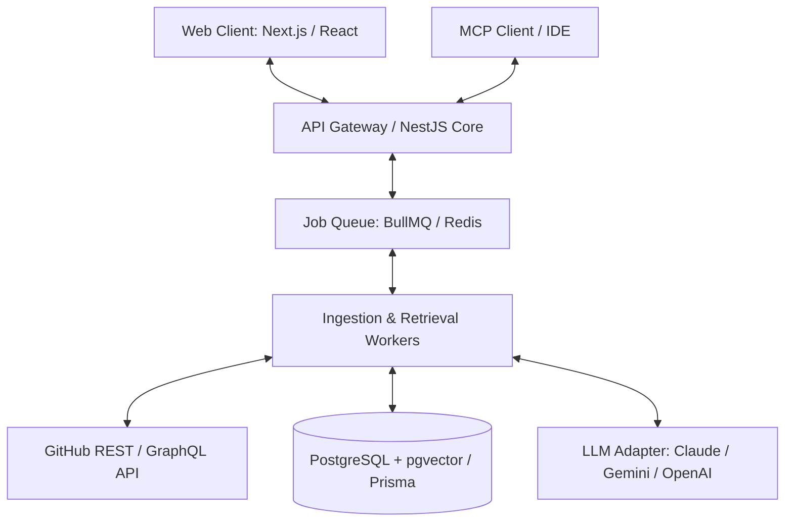

# Traceback Architecture System Overview

> **Version:** 1.0.0-provisional | Last Updated: 2026-10-09  
> **Status:** Architecture Baseline & ADR Index

---

## 1. System Topology & Architectural Principles
Traceback is structured as a modular, evidence-centric system designed to ingest, index, and verify historical repository rationale against AI-generated code explanations.

### Architectural Tenets
1. **Provenance First:** Every retrieved record must trace immutably to a commit SHA, PR number, issue ID, or documentation file path.
2. **Untrusted Ingestion:** All repository content is treated as untrusted text to prevent prompt injection attacks.
3. **Calibrated Abstention:** Systems abstain with "Insufficient Evidence" when retrieval confidence falls below thresholds.
4. **Separation of Assessment and Verdict:** AI provides confidence heuristics; humans render authoritative verdicts.
5. **No Premature Graph Complexity:** Relational indices with hybrid vector search serve as baseline before considering dedicated graph databases.

---

## 2. Architecture Decision Records (ADR) Summary Index

| ADR ID | Title | Status | Primary Decision / Recommendation |
| :--- | :--- | :--- | :--- |
| **ADR-001** | Repository & Workspace Structure | Accepted (Provisional) | Adopt Turborepo monorepo (`apps/web`, `apps/api`, `packages/shared-types`). |
| **ADR-002** | Frontend & Backend Framework Organisation | Accepted (Provisional) | Next.js (App Router, React, TypeScript) frontend with NestJS modular API backend. |
| **ADR-003** | Evidence Storage & Provenance Data Model | Accepted | PostgreSQL with Prisma ORM; strict immutable foreign keys for Git commit SHAs, PRs, and issues. |
| **ADR-004** | Search & Retrieval Baseline | Accepted | Hybrid retrieval combining BM25 full-text search with pgvector dense embeddings. |
| **ADR-005** | Neo4j & Graph Database Justification Criteria | Deferred / Conditional | Defer Neo4j for V1 baseline; re-evaluate in Sprint 4 against explicit recall benchmarks. |
| **ADR-006** | AI Assessment Boundaries & Human Verdict Adjudication | Accepted | Model performs claim extraction and preliminary confidence scoring; human verdict is strictly decoupled. |
| **ADR-007** | GitHub App Integration & Minimum Privilege Access | Accepted | GitHub App with read-only repository contents, issues, and PR permissions; zero write access. |
| **ADR-008** | Asynchronous Background Ingestion & Job Queue | Accepted | Redis-backed BullMQ queue for chunked repository sync and webhook processing. |
| **ADR-009** | Model Context Protocol (MCP) Integration Strategy | Planned (Sprint 7) | Expose read-only MCP server tools for IDE clients once web workflow is validated. |
| **ADR-010** | Deployment Topology & Operational Cost Controls | Accepted | Containerized deployment (Docker); strict token budgeting (<8k prompt tokens/review). |
