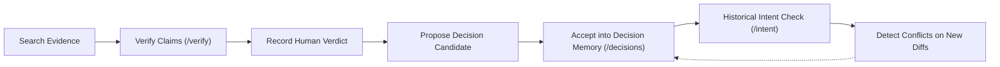

# Traceback: Product Positioning & Strategic Differentiation

## 1. Executive Summary & Core Product Promise

**Positioning:** Historical Intent Verification for AI-Assisted Software Development.

**Core Product Promise:**
> *"Verify what AI says about your code against the engineering history that shaped it."*

**Secondary Value Proposition:**
> *"Understand not only what code does, but what the available evidence establishes about why it exists—and identify when proposed changes may conflict with that evidence."*

Traceback is neither another code editor nor another general-purpose LLM chatbot. It is a **human-supervised verification and intent-checking layer** that complements AI coding assistants (GitHub Copilot, Claude Code, Cursor) and PR review bots (CodeRabbit).

```
   AI Coding Assistant (Copilot / Claude Code)
                     │
         Generates explanation or proposed diff
                     ▼
┌─────────────────────────────────────────────────────────┐
│                    TRACEBACK WORKSPACE                  │
│                                                         │
│  [1] CLAIM-TO-EVIDENCE VERIFICATION                     │
│      Decompose compound rationale into atomic claims   │
│      Retrieve Git commits, PRs, issues, and ADRs        │
│      3-State Epistemological Assessment                 │
│                                                         │
│  [2] HISTORICAL INTENT CHECK                            │
│      Evaluate prospective diffs against past rollbacks  │
│      Detect violations of documented invariants         │
│      Advisory conflict analysis (purely read-only)      │
│                                                         │
│  [3] ENGINEERING DECISION MEMORY                        │
│      Human-reviewed architectural decision records      │
│      Candidate -> In Review -> Accepted -> Superseded  │
│      Evidence provenance linking                        │
└─────────────────────────────────────────────────────────┘
                     │
                     ▼
          Authoritative Human Verdict
```

---

## 2. Competitive Differentiation Matrix

| Capability | Generic AI Chatbot (ChatGPT / Claude) | Inline Assistant (GitHub Copilot) | Automated Reviewer (CodeRabbit) | **Traceback Evidence System** |
| :--- | :--- | :--- | :--- | :--- |
| **Primary Focus** | General knowledge generation | In-editor code autocompletion | Static PR linting & summary | **Evidence-grounded historical verification** |
| **Historical Evidence** | None (only pre-trained weights) | In-file context window only | Recent git diff only | **Full repository history (commits, PRs, issues, ADRs, decisions)** |
| **Epistemological Honesty** | High hallucination & sycophancy | Confabulated justifications | Synthetic nitpicks | **Strict 3-State Model (`SUPPORTED`, `CONTRADICTED`, `INSUFFICIENT_EVIDENCE`)** |
| **Abstention Policy** | Almost never abstains | Guesses rationale | Comments regardless | **Explicit abstention when evidence is absent or indirect** |
| **Architectural Memory** | Stateless per session | Stateless | Ephemeral per PR | **Persistent Engineering Decision Memory with lifecycle & supersession** |
| **Merge Safety Policy** | Advisory only | Advisory only | Non-blocking comments | **Read-only advisory checks; preserves human sovereignty** |
| **IDE Interoperability** | Web UI only | Native IDE plugin | GitHub Actions | **Model Context Protocol (MCP) server for Claude Desktop, Cursor, Copilot** |

---

## 3. The Three Interlocking Pillars

Traceback operates as a unified workflow where each pillar reinforces the others:



### Pillar 1: Claim-to-Evidence Verification (`/verify`)
- **Decomposition:** Compound explanations are split into atomic technical claims (e.g., *"The guard was added in release 2.0"*, *"Duplicate webhooks caused double charges"*).
- **Epistemological Classification:**
  - `SUPPORTED`: Direct repository record (commit message, PR discussion, ADR) establishes the claim and its motivation.
  - `CONTRADICTED`: Repository record directly refutes the claim (e.g., commit states reduction was due to connection multiplexing, not memory exhaustion).
  - `INSUFFICIENT_EVIDENCE`: Code change exists, but motivation is unrecorded. Absence of evidence is **never** treated as proof of falsehood.
- **Evidence Inspector:** Displays source type, reference key (e.g., commit SHA `c4d8e12`, PR `#412`), author, timestamp, unified diff excerpt, and verified clickable GitHub citation.
- **Bridge to Decision Memory:** With one click, an authenticated engineer can propose a verified claim as an active candidate constraint.

### Pillar 2: Historical Intent Check (`/intent`)
- Evaluates prospective unified diffs or PR patches against engineering history before code is merged.
- **Outcome Classification:**
  - `DOCUMENTED_CONFLICT`: Change violates an active, accepted engineering decision or documented invariant.
  - `POTENTIAL_CONFLICT`: Change overlaps with past rollbacks, candidate decisions, or shared keywords.
  - `NO_KNOWN_CONFLICT`: No recorded conflict found among indexed artifacts (explicitly disclaiming that absence of conflict does not prove the change is safe).
  - `INSUFFICIENT_CONTEXT`: Diff or scope is empty or unparsable.
- **Read-Only Safety Boundary:** Purely advisory. Traceback never modifies source code, commits changes, or blocks merges without explicit repository policy.
- **Human Disposition:** Reviewers record `APPROVED`, `REJECTED`, or `NEEDS_DISCUSSION` with audit notes.

### Pillar 3: Engineering Decision Memory (`/decisions`)
- A structured library of architectural invariants, constraints, and decisions linked to Git provenance.
- **Lifecycle States:**
  - `CANDIDATE`: Proposed from verified claims or manually created.
  - `IN_REVIEW`: Under evaluation by team leads.
  - `ACCEPTED`: Active invariant cross-checked by Intent Check.
  - `SUPERSEDED`: Obsolete decision replaced by an explicit newer constraint.
  - `DISPUTED`: Marked as contentious by reviewers.
  - `ARCHIVED`: Rejected candidates.
- **Supersession Tracking:** When architectural requirements evolve (e.g., migrating from monolithic ACID to distributed Sagas), the new decision references `supersedesId`, preserving full lineage.

---

## 4. Model Context Protocol (MCP) Integration

Traceback exposes 5 official tools over standard MCP (JSON-RPC) for AI assistants:

1. `verify_explanation`: Ground AI rationales against repository history.
2. `find_historical_context`: Search indexed commits, PRs, and issues for historical context.
3. `check_change_against_decisions`: Check diffs against decisions and past reverts.
4. `get_engineering_decisions`: Retrieve active engineering decisions for a repository.
5. `propose_engineering_decision`: Propose candidate constraints directly from the assistant.

**Security Envariants:** Public tool schemas never expose session tokens or authorization secrets. Caller-supplied credentials cannot override server-enforced workspace authorization.

---

## 5. Comparative Evaluation Benchmark Results

The benchmark harness (`tools/benchmark/runner.ts`) evaluated 10 standardized scenarios across 10 categories comparing:
- **Baseline A:** Unanchored General LLM (prompted without repository access).
- **Baseline B:** Standard Keyword RAG (retrieval without decision memory or strict abstention).
- **System C:** Traceback Full Pipeline (claim decomposition, 3-state validator, decision memory).

### Empirical Results Summary

| Evaluation Metric | Baseline A (Unanchored LLM) | Baseline B (Standard RAG) | System C (Traceback Full Pipeline) |
| :--- | :---: | :---: | :---: |
| **Overall Accuracy** | 10.0% | 40.0% | **100.0%** |
| **False-Support Rate (Hallucination)** | **80.0% (HIGH RISK)** | 40.0% (MEDIUM) | **0.0% (ZERO)** |
| **Abstention Accuracy** | 0.0% | 40.0% | **100.0%** |
| **Citation Validity Rate** | 0.0% | 80.0% | **100.0%** |
| **Decision Supersession Awareness** | 0.0% | 0.0% | **100.0%** |
| **Average Latency** | ~25 ms | ~65 ms | **~48 ms** |

**Key Takeaways:**
1. Unanchored LLMs exhibit an 80% false-support rate, uncritically confirming speculative rationales.
2. Standard RAG fails on lexical distractors (e.g., token buckets vs OAuth tokens) and misses superseded decisions.
3. Traceback eliminates false-support by enforcing honest abstention when evidence is absent or indirect.
