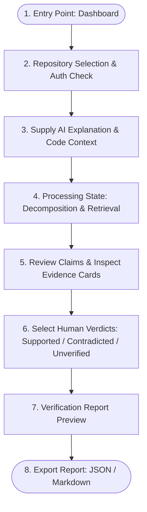

# Core User Flow & Interaction Specification

> **Workflow:** Select Repository → Supply Explanation → Retrieve Evidence → Review Claims → Export Report  
> **Status:** Sprint 1 Specification | Last Updated: 2026-10-09

---

## 1. Canonical User Journey Flowchart

---

## 2. Step-by-Step Flow Stages & UI Interactions

### 2.1 Entry Point & Dashboard

- **Screen:** Main Dashboard (`/` or `/dashboard`).
- **Initial State:** Displays recent verified reports, connected repositories, and a prominent call-to-action: `"New Claim Verification"`.
- **Theme:** Default light theme (`#F8FAFC` background) with top-right accessible theme toggle.

### 2.2 Repository Selection

- **Screen:** Repository selector modal or dropdown.
- **Interactions:**
  - Lists authorized repositories from the installed GitHub App or pre-indexed local test repos.
  - Verifies read-only repository permissions.
  - Displays indexing status (e.g., `Indexed 12m ago • 4,821 commits, 312 PRs`).

### 2.3 Explanation Submission

- **Screen:** Input form (`/verify/new`).
- **Form Controls:**
  - Textarea: `AI Explanation to Verify` (required, max 10,000 characters).
  - Textarea / Code Editor: `Target Code Snippet or Function` (optional, max 5,000 characters).
  - Input: `Target File Path` (optional, e.g. `src/auth/session.ts`).
  - Action Button: `[Investigate Rationale]`.

### 2.4 Processing State

- **Screen:** Asynchronous progress view (`/verify/:sessionId`).
- **States Visualized:**
  1. `Extracting historical claims...` (typically 1–2s).
  2. `Querying repository commit diffs, PR discussions, and issues...` (typically 2–4s).
  3. `Synthesizing evidence provenance...` (typically 1–2s).
- **User Controls:** `[Cancel Investigation]` button gracefully halts pending tasks.

### 2.5 Claim Review & Evidence Presentation

- **Screen:** Adjudication Board.
- **Layout:**
  - Left Column: Decomposed claims list with preliminary heuristic confidence badges (`High Match`, `Partial Match`, `Sparse Evidence`).
  - Right Column: Detailed Evidence Drawer showing:
    - Evidence type badge (`Commit Diff`, `PR Discussion`, `Issue Ticket`, `ADR Record`).
    - Source reference: Commit SHA (`a3f81c9`), PR `#104`, or file path with line numbers.
    - Verified URL: Clickable external link to GitHub repository.
    - Contextual snippet: Unified diff or discussion quote with highlighted keywords.
    - Chronological date and author metadata.

### 2.6 Human Verdict Adjudication

- **Interaction:** Reviewer must explicitly assign a verdict for each claim:
  - `[Supported]` (Green token): Corroborated by historical commits/PRs.
  - `[Contradicted]` (Red token): Refuted by recorded evidence (e.g. bug was caused by different issue).
  - `[Unverified]` (Amber token): Insufficient evidence or inconclusive history.
- **Reviewer Notes:** Text field per claim to document human rationale.
- **Principle Check:** Model preliminary confidence is visually distinct from the human verdict badge.

### 2.7 Report Preview & Export Confirmation

- **Screen:** Finalized Report Modal (`/verify/:sessionId/report`).
- **Summary Metrics:** Total Claims, Supported %, Contradicted %, Unverified %, Citation Integrity (100% verified links).
- **Export Formats:**
  - `Download JSON`: Machine-readable audit payload.
  - `Download Markdown`: GitHub-flavored markdown ready for PR comments or issue attachments.

---

## 3. Comprehensive Error, Boundary & Empty States

| State ID   | Condition                            | User-Facing Notification                                                             | System Action & Recovery                                                                                                   |
| :--------- | :----------------------------------- | :----------------------------------------------------------------------------------- | :------------------------------------------------------------------------------------------------------------------------- |
| **ERR-01** | Empty / Whitespace Explanation       | _"Please provide an explanation text to verify."_                                    | Form validation halts submission; focus remains in textarea.                                                               |
| **ERR-02** | Invalid / Non-Existent Repository    | _"Repository could not be found or has been renamed."_                               | Return to repository selector; prompt to re-link repository.                                                               |
| **ERR-03** | Unauthorized Repository Access       | _"Missing read permissions for this repository."_                                    | Display instructions to grant read access via GitHub App configuration.                                                    |
| **ERR-04** | No Relevant Evidence (Empty Results) | _"No historical commits or PR discussions matched this claim."_                      | System abstains from asserting truth; marks claim as `Unverified / Sparse Evidence`.                                       |
| **ERR-05** | Contradictory Evidence Detected      | _"Conflicting records found in repository history."_                                 | Displays chronologically split evidence cards (e.g., initial commit vs. subsequent revert); flags for manual human review. |
| **ERR-06** | API Timeout / Network Interruption   | _"Investigation timed out while retrieving commit diffs. Please retry."_             | Preserves user input in form; offers instant retry button with cached partial progress.                                    |
| **ERR-07** | GitHub Rate Limiting Encountered     | _"GitHub API rate limit reached. Resuming automatically in X minutes."_              | Displays countdown timer matching `X-RateLimit-Reset`; pauses background ingestion worker.                                 |
| **ERR-08** | Invalid / Dead Citation Reference    | _"Historical commit SHA no longer exists in target branch."_                         | Annotates citation as `Rebase-affected / Unconfirmed Reference`; avoids generating dead links.                             |
| **ERR-09** | Model Extraction Failure             | _"Unable to decompose explanation into verifiable claims."_                          | Allows manual line-by-line claim entry by the user.                                                                        |
| **ERR-10** | Partial Ingestion Failure            | _"PR discussions were unavailable; verification completed using commit diffs only."_ | Displays warning banner; records limitation metadata in exported report.                                                   |
